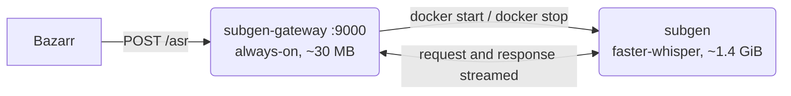

# subgen-gateway

Wake-on-demand gateway for a [Subgen](https://github.com/mccloud/subgen) Whisper
(faster-whisper) subtitle server.

Subgen keeps ~1.4 GiB of RSS resident even when completely idle. This tiny, always-on proxy
**wakes the Subgen container when a transcription request arrives** and **stops it again
after it has been idle**, so that memory is only spent while subtitles are actually being
generated.

## Motivation

Subgen (faster-whisper) held **~1.4 GiB of RSS while completely idle** — the model stays
resident in the process between requests. On a host with almost no free RAM, that is memory
other workloads can use. But Bazarr must still be able to reach its Whisper provider
automatically, at any moment, with no manual `docker start` in the loop.

`subgen-gateway` hides the start/stop dance from Bazarr entirely: a ~30 MB always-on
container that fronts the real backend.

## Architecture



Bazarr's Whisper endpoint points at `http://subgen-gateway:9000` (or the published host
port) instead of `http://subgen:9000`. Bazarr does not need to know the backend was asleep.

## How it works

1. **Wake on demand.** A request on any path other than `/gateway/status` arrives. If the
   backend is not answering `GET /status`, the gateway calls `docker start` on
   `BACKEND_CONTAINER` and polls until the backend is ready — in practice this takes about
   3 seconds; `WAKE_TIMEOUT_SECONDS` caps the wait.
2. **Stream through.** The request is forwarded to the backend and its body is streamed in
   256 KiB chunks (uploads can be hundreds of MB of raw PCM audio); the response is relayed
   back to the client.
3. **Idle stop.** A background monitor runs every `CHECK_INTERVAL_SECONDS` and stops the
   backend when nothing is in flight and it has been idle for **more than**
   `IDLE_STOP_SECONDS` (strictly `inflight == 0 and idle > IDLE_STOP_SECONDS`).
4. **Introspect without waking.** `GET /gateway/status` returns the current state and never
   wakes the backend, so it is safe for monitoring.

If a wake fails, the gateway answers `503` with a JSON error and leaves the backend alone.

## Configuration

All configuration is via environment variables:

| Variable                 | Default | Description                                                              |
| ------------------------ | ------- | ------------------------------------------------------------------------ |
| `BACKEND_CONTAINER`      | `subgen`| Name of the Docker container the gateway starts and stops.               |
| `BACKEND_HOST`           | `subgen`| Hostname used to reach the backend's HTTP API.                          |
| `BACKEND_PORT`           | `9000`  | Backend HTTP port.                                                       |
| `LISTEN_PORT`            | `9000`  | Port the gateway listens on.                                             |
| `IDLE_STOP_SECONDS`      | `900`   | Stop the backend after this many seconds with no requests (strict `>`).  |
| `CHECK_INTERVAL_SECONDS` | `30`    | How often the idle monitor evaluates the stop condition.                 |
| `WAKE_TIMEOUT_SECONDS`   | `300`   | Max seconds to wait for the backend to become ready after a start.       |
| `READ_TIMEOUT_SECONDS`   | `7200`  | Socket timeout for proxied backend requests (long transcriptions).       |

## HTTP API

### `GET /gateway/status`

Returns the gateway's current state as JSON. Never wakes the backend — safe for monitoring.

```json
{
  "backend_container": "subgen",
  "backend_running": true,
  "backend_ready": true,
  "inflight": 0,
  "idle_seconds": 42.7,
  "idle_stop_seconds": 900
}
```

| Field                | Meaning                                                                  |
| -------------------- | ------------------------------------------------------------------------ |
| `backend_container`  | Name of the managed container (`BACKEND_CONTAINER`).                     |
| `backend_running`    | Whether Docker reports that container as running.                        |
| `backend_ready`      | Whether the backend answers `GET /status` with 200 (false if not running).|
| `inflight`           | Number of requests currently being proxied.                              |
| `idle_seconds`       | Seconds since the last proxied request finished.                         |
| `idle_stop_seconds`  | The configured idle threshold.                                           |

### Everything else

Any other path and method is proxied to the backend: the gateway wakes it first, then
streams the request through and relays the response. If the backend cannot be woken, the
gateway responds `503` with a JSON error.

## Operational notes

- **Mounting the Docker socket is root-equivalent.** `/var/run/docker.sock` grants full
  control over the Docker daemon (any container, any volume, `docker exec`, ...). Run this
  gateway only on hosts and networks you trust, and never expose it or the socket to
  untrusted networks.
- **If the gateway is down, whisper requests fail harmlessly.** Bazarr's requests get a
  connection error and are logged, but nothing is corrupted and no resources leak.
  `restart: unless-stopped` keeps this window small.
- **`docker compose up -d` starts the backend.** A compose (re)deploy starts `subgen` like
  any other service; if nothing uses it, the gateway stops it again after
  `IDLE_STOP_SECONDS`. No action needed — that is the intended behavior.
- **The backend container must already exist.** The gateway starts and stops it; it does
  not create it. Create it once with your normal compose flow before relying on the wakes.

## Quick start

```bash
# Build the image
docker build -t subgen-gateway .

# Run it (the backend container `subgen` must already exist)
docker run -d --name subgen-gateway --restart unless-stopped \
  -p 9000:9000 \
  -e TZ=America/New_York \
  -v /var/run/docker.sock:/var/run/docker.sock \
  subgen-gateway

# Check the state (this does not wake the backend)
curl -s http://localhost:9000/gateway/status
```

On a Docker Compose network no port publish is needed — point Bazarr at
`http://subgen-gateway:9000`. See `docker-compose.example.yml` for a starting point.

## Running the tests

The unit tests cover the pure `should_stop` decision function. They stub
`docker.from_env()` before importing the module, so no Docker daemon or socket is needed:

```bash
docker run --rm -v "$PWD:/app:ro" -w /app -e PYTHONDONTWRITEBYTECODE=1 python:3.12-slim \
  sh -c 'pip install -q "docker>=7,<8" && python -m unittest discover -s tests -v'
```

## License

MIT — see [LICENSE](LICENSE).
